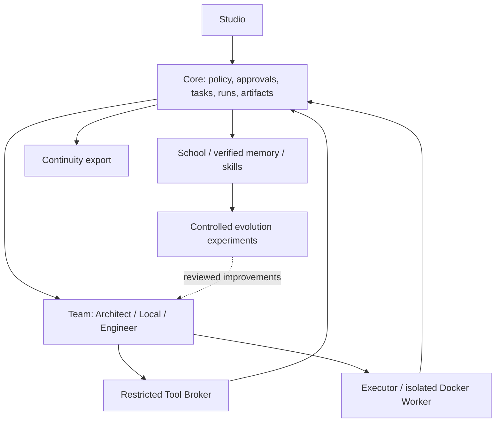

# II PRO Studio

**Building independent, local-first engineering intelligence.**

Experimental research platform for autonomous software engineering with local models, cloud mentors, controlled tools, reproducible verification and experience-driven improvement.

[Roadmap (RU)](docs/ROADMAP.md) · [Studio documentation](ui/README.md) · [Contributing](CONTRIBUTING.md) · [Security](SECURITY.md) · [II PRO Research](https://github.com/ii-pro-research)

## Mission / Цель

Build a system that can plan and execute real engineering tasks, check its own work, acquire verified skills and progressively reduce its dependence on cloud providers. The intelligence is the combination of models, memory, tools, orchestration and independent evaluation, not a single language model.

Создаём собственный инженерный интеллект: локальные модели постепенно становятся основными исполнителями, а облачные модели помогают как инженеры, наставники и проверяющие. Сохраняем одно ядро, единые разрешения и воспроизводимые доказательства.

## Current evidence

| Capability | Status |
| --- | --- |
| Core, scoped approvals and artifact journal | Implemented |
| Local model and restricted tool broker | Implemented; reasoning quality remains limited |
| Hybrid Architect / Local / Engineer workflow | Demonstrated on one bounded engineering task |
| Docker functional acceptance | 11/11 scenarios in L.6.4c |
| Automatic candidate repair | Mock-tested; not needed in the successful live trial |
| Continuity export | Implemented in M.1; fresh-chat transfer still needs practical validation |
| School, skills and evolution | Experimental; durable improvements not yet established |
| Telegram gateway, broader local-first autonomy | Planned |

The successful L.6.4c trial took 156.60 seconds with one owner approval, three cloud requests, one local generation, one table computation and one Worker run. The original application remained unchanged. This is evidence of a bounded hybrid workflow, not general autonomous intelligence. The learning material remains `unreviewed`.

See [L.6.4c](docs/STAGE_L64C_PREAPPLY_REPAIR.md), [M.1](docs/STAGE_M1_CONTINUITY.md) and [Local Engine](docs/LOCAL_ENGINE_STUDIO.md). The reported L.6.4c regression was 1046 passed Python tests, one skip and 37 DevKit tests; M.1 reported 73 passed Python tests, one skip, 96 UI tests and a successful production build. These are historical test results, not a current CI badge.

## Architecture



Core owns state and execution authority. Observations are preserved separately from model interpretations. Experimental changes require independent evaluation and explicit release decisions; agents cannot grant themselves new permissions.

| Module | Responsibility |
| --- | --- |
| `ii_pro_core` | Task, run, approval, artifact and event management |
| `ii_pro_local` | Local model, restricted tools, skills and recovery |
| `ii_pro_team` | Hybrid orchestration, cloud adapter, engineering and evolution |
| `ii_pro_worker` | Isolated execution and functional verification |
| `ii_pro_school` | Curriculum, independent exams and experience evaluation |
| `ii_pro_ui`, `ui` | Local Studio, API, React interface and continuity export |

## Getting started (Windows)

Requirements: Python 3.12+, Git. Node.js is required to rebuild the frontend, not to view the checked-in build. Ollama and Docker are needed only for the respective live workflows. The public Alpha starts without the SIWC DevKit. Cloud execution through that bridge is unavailable in this distribution.

```powershell
py -3.12 -m venv .venv
.\.venv\Scripts\python.exe -m ii_pro_ui --no-docker-probe
```

Run these commands from the root of the unpacked Alpha or your checkout. Studio opens on loopback. Start with a fresh checkout; this command is not a full reconstruction of the project's live working state. Do not expose the session URL, database or API to the internet. A live engineering profile needs explicitly registered project snapshots, a reviewed Worker image, model configuration and owner approvals. See [Studio instructions](ui/README.md) and [Local Engine instructions](docs/LOCAL_ENGINE_STUDIO.md).

After creating the local `.venv`, you can open `Start-Studio.cmd` by double-clicking. Both Windows launchers use the snapshot's own Python environment and default local state directory. Do not substitute a live database for a fresh scratch directory during a smoke check.

### Core demo and command line

```powershell
.\.venv\Scripts\python.exe examples/demo.py
.\.venv\Scripts\python.exe -m ii_pro_core --help
```

The demo and its [source](examples/demo.py) show the Python API, idempotency, artifact validation and recovery using a temporary state directory. For persistent demo data, use `examples/demo.py --state-dir .local/demo-new`; that path must not already contain a Core database. The JSON CLI exposes task and Run lifecycle, approvals, artifacts and the event journal. Start with separate scratch state, for example `python -m ii_pro_core --state-dir .local/cli-demo create --title "Demo" --key task-1`.

Core uses an exclusive state-directory owner lock, SQLite migrations and scoped, hashed artifacts. Back up the database and any file-based artifacts separately. A successful executor result enters verification; a failed or interrupted Run retains its history. Only a trusted operator may reconcile an `unknown` against actual local or external stop evidence. A Python executor loaded in Core is trusted code. Model-generated application code uses the separate Worker boundary.

## Getting started (Linux)

From the unpacked Alpha or a checkout with Python 3.12:

```sh
python3.12 -m venv .venv
.venv/bin/python -m ii_pro_ui --no-docker-probe
```

## Development checks

```powershell
.\.venv\Scripts\python.exe -m pip install -r requirements-test.lock
.\.venv\Scripts\python.exe -m pytest -q
```

Frontend development (from the repository root):

```powershell
Set-Location ui
npm.cmd ci --ignore-scripts
npm.cmd test
npm.cmd run build
```

Some local or integration fixtures require additional setup. Missing fixtures must be reported, not silently treated as success. Do not launch live models or Worker merely to run unit tests.

## Project continuity

Studio can generate `II_PRO_CONTINUE.zip` from selected Git documents and a bounded Core state projection. It is a context snapshot, not a complete backup and not a transferable execution grant. See [Continuity Engine](docs/STAGE_M1_CONTINUITY.md).

The repository intentionally excludes live databases, private evidence, model weights, credentials, tokens and local environments. Restore operational data separately from protected backups.

Continuity export requires a Git checkout with the selected documents committed. A standalone snapshot can start Studio and verify an existing Continuity package without Git history. To try export locally, initialize and commit the clean snapshot in a separate temporary checkout.

## Research influences

Hermes Agent (agent loops, tools and context), Harness² (controlled evaluation and improvement), Asset Vault (resource-management ideas) and Telegram (remote interaction). These are research references, not claims that those projects are integrated. See the [roadmap](docs/ROADMAP.md).

## License and third-party materials

See [release licensing](docs/RELEASE_LICENSING.md) and the [UI notices](ui/THIRD_PARTY_NOTICES.txt). II PRO-authored material is licensed under Apache-2.0. Bundled components retain their separate terms. No affiliation with external providers or research projects is implied.

**Research software. Not production-ready.**
